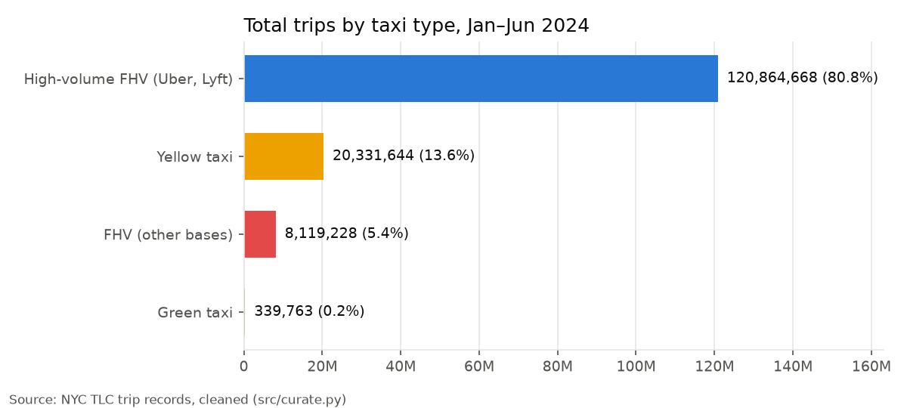
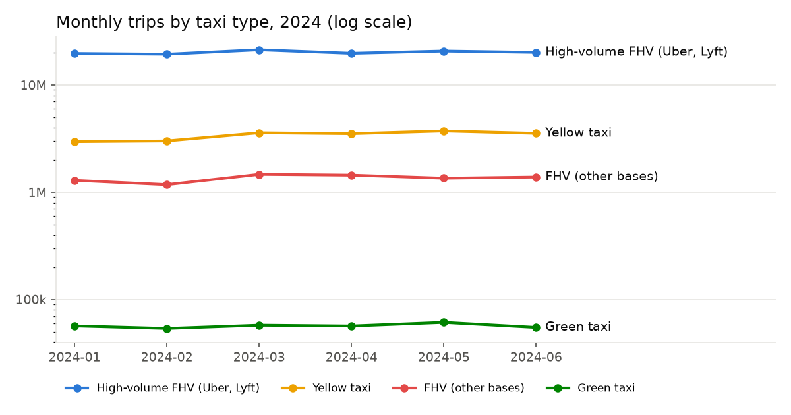
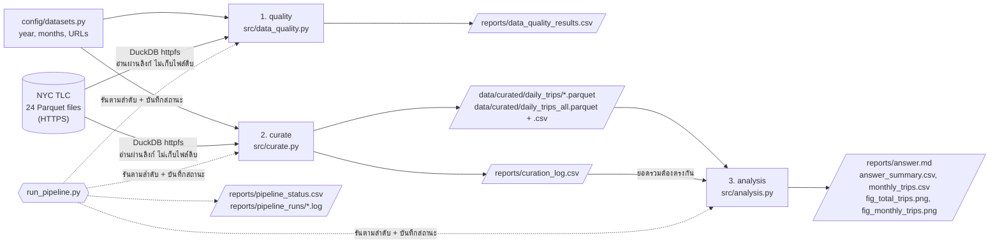

# NYC Taxi: Data Lifecycle & Pipeline

**โจทย์:** Which taxi type was the most used in the first half of 2024?

**คำตอบ:** **High-volume FHV (Uber, Lyft)** ถูกใช้มากที่สุด มี **120,864,668 เที่ยว** (80.8% ของเที่ยวทั้งหมด) มากกว่าอันดับ 2 คือ Yellow taxi (20,331,644 เที่ยว) ประมาณ **5.9 เท่า** และเป็นอันดับ 1 ทุกเดือนตั้งแต่มกราคมถึงมิถุนายน 2024

| อันดับ | ประเภท | จำนวนเที่ยว (ม.ค.–มิ.ย. 2024) | สัดส่วน | เฉลี่ยต่อวัน |
|---|---|---|---|---|
| 1 | High-volume FHV (`fhvhv`) | 120,864,668 | 80.76% | 664,092 |
| 2 | Yellow taxi (`yellow`) | 20,331,644 | 13.59% | 111,712 |
| 3 | FHV, other bases (`fhv`) | 8,119,228 | 5.43% | 44,611 |
| 4 | Green taxi (`green`) | 339,763 | 0.23% | 1,867 |




> กราฟรายเดือนใช้แกน y แบบ **log scale** เพราะจำนวนเที่ยวของ green น้อยกว่า fhvhv ประมาณ 400 เท่า ถ้าใช้แกนปกติ เส้นของ green จะแบนติดศูนย์จนอ่านไม่ออก

---

## 1. ข้อมูลที่ใช้

| | |
|---|---|
| แหล่งข้อมูล | NYC Taxi & Limousine Commission (TLC) Trip Record Data |
| วิธีเข้าถึง | ลิงก์ HTTPS สาธารณะ: `https://d37ci6vzurychx.cloudfront.net/trip-data/<file>.parquet` |
| ช่วงเวลา | มกราคม–มิถุนายน 2024 (6 เดือน) |
| ประเภท taxi | `yellow`, `green`, `fhv`, `fhvhv` รวม 4 ประเภท × 6 เดือน = **ไฟล์ Parquet 24 ไฟล์** |
| การตั้งค่า | `config/datasets.py` (ปี, เดือน, URL ของทุกไฟล์) |

ทั้ง 4 ประเภท **มีโครงสร้างไม่เหมือนกัน** คอลัมน์ที่ใช้และการจับคู่ให้เป็นโครงสร้างเดียวกัน:

| ฟิลด์กลาง | yellow | green | fhv | fhvhv |
|---|---|---|---|---|
| เวลารับผู้โดยสาร | `tpep_pickup_datetime` | `lpep_pickup_datetime` | `pickup_datetime` | `pickup_datetime` |
| เวลาส่งผู้โดยสาร | `tpep_dropoff_datetime` | `lpep_dropoff_datetime` | `dropOff_datetime` | `dropoff_datetime` |
| ระยะทาง (ไมล์) | `trip_distance` | `trip_distance` | *(ไม่มี)* | `trip_miles` |

การจับคู่นี้อยู่ที่เดียว (`COLUMNS` ใน `src/data_quality.py`) และทุกขั้นของ pipeline ใช้ร่วมกัน

## 2. โครงสร้าง Pipeline



| ขั้น | ทำอะไร | ผลลัพธ์ |
|---|---|---|
| **1. quality** | ตรวจแต่ละไฟล์: จำนวนแถว, ค่าว่างใน pickup/dropoff, ระยะทางติดลบ โดยอ่านสถิติใน footer ของ Parquet ก่อน และสแกนคอลัมน์จริงเฉพาะเมื่อสถิติไม่มีหรือไม่พอ | `reports/data_quality_results.csv` |
| **2. curate** | แปลงแต่ละประเภทเป็นโครงสร้างกลาง ติดป้ายทุกแถวว่า `kept` หรือเหตุผลที่ตัดทิ้ง แล้วรวมเป็น **1 แถวต่อวันต่อประเภท** ทั้งหมดนี้ใช้การดึงข้อมูลรอบเดียวต่อไฟล์ | `data/curated/daily_trips/<type>_<YYYY-MM>.parquet` (หนึ่งไฟล์ต่อไฟล์ต้นทาง), `data/curated/daily_trips_all.parquet` / `.csv` (ตารางรวม), `reports/curation_log.csv` |
| **3. analysis** | ตรวจว่ามีข้อมูลครบ 24 ไฟล์ และยอดรวมใน curated ตรงกับ `kept_rows` ใน curation log จากนั้นจัดอันดับและสร้างกราฟ | `reports/answer.md`, `answer_summary.csv`, `monthly_trips.csv`, กราฟ 2 รูป |
| **ตัวรันหลัก** | `run_pipeline.py` รันทุกขั้นตามลำดับ หยุดเมื่อขั้นใดล้มเหลว และบันทึกหลักฐานทุกรอบ | `reports/pipeline_status.csv`, `reports/pipeline_runs/run_<id>.log` |

กฎการทำความสะอาด (`src/curate.py`) ตรวจตามลำดับ:

| เหตุผล | กฎ |
|---|---|
| `out_of_period` | ไม่มีเวลารับผู้โดยสาร หรือเวลารับไม่อยู่ในเดือนของไฟล์นั้น |
| `bad_timestamp` | ไม่มีเวลาส่งผู้โดยสาร หรือเวลาส่งก่อนเวลารับ |
| `negative_distance` | ระยะทาง < 0 (เฉพาะ yellow, green, fhvhv) |

### ชุดข้อมูลพร้อมใช้ (Curated dataset)

`data/curated/daily_trips_all.csv` (ข้อมูลเดียวกับไฟล์ `.parquet`) 1 แถวต่อวันต่อประเภท:

| คอลัมน์ | ความหมาย |
|---|---|
| `trip_date` | วันที่รับผู้โดยสาร |
| `taxi_type` | `yellow`, `green`, `fhv`, `fhvhv` |
| `trips` | จำนวนเที่ยวที่เหลือหลังทำความสะอาด |
| `total_miles` | ระยะทางรวม **ว่างสำหรับ `fhv`** (ไฟล์ต้นทางไม่มีคอลัมน์ระยะทาง) |
| `source_file` | ไฟล์ TLC ที่แถวนี้มาจาก (ใช้ตรวจย้อนกลับ) |

## 3. การติดตั้ง

ต้องใช้ Python 3.11 ขึ้นไป และต้องต่ออินเทอร์เน็ต (ข้อมูลอ่านจากลิงก์ของ TLC)

```bash
git clone https://github.com/<your-account>/NYC-Taxi-Data-Lifecycle-Pipeline.git
cd NYC-Taxi-Data-Lifecycle-Pipeline
python -m venv .venv
# Windows: .venv\Scripts\activate    macOS/Linux: source .venv/bin/activate
pip install -r requirements.txt
```

ไม่ต้องมีบัญชี AWS และไม่ต้องดาวน์โหลดไฟล์ข้อมูล DuckDB จะติดตั้ง extension `httpfs` ให้เองตอนรันครั้งแรก

## 4. วิธีรัน

รันทุกคำสั่งจากโฟลเดอร์หลักของโปรเจกต์

```bash
python run_pipeline.py                  # รันทุกขั้น (แบบ incremental)
python run_pipeline.py --only analysis  # รันขั้นเดียว
python run_pipeline.py --from curate    # เริ่มจากขั้นที่ระบุ
python run_pipeline.py --force          # สร้างใหม่ทั้งหมดจากต้นทาง
```

รันทีละขั้นโดยตรงก็ได้: `python -m src.data_quality`, `python -m src.curate`, `python -m src.analysis`

**เมื่อมีข้อมูลใหม่:** เพิ่มเดือนใน `config/datasets.py` (เช่น `MONTHS = range(1, 13)`) แล้วรัน `python run_pipeline.py` อีกครั้ง ระบบจะอ่านเฉพาะไฟล์ใหม่ และคำนวณผลวิเคราะห์ใหม่จากทุกเดือน

**ถ้าการรันถูกขัดจังหวะ หรือต้นทางตอบ HTTP 403:** รันคำสั่งเดิมอีกครั้งภายหลัง ไฟล์ที่เสร็จแล้วจะถูกข้าม จะลองใหม่เฉพาะไฟล์ที่ยังไม่เสร็จ

## 5. หลักฐานการรัน Pipeline

- `reports/pipeline_status.csv`: หนึ่งแถวต่อหนึ่งขั้นต่อหนึ่งรอบ มีสถานะ (`SUCCESS` / `PARTIAL` / `FAILED`) เวลาเริ่ม เวลาที่ใช้ และไฟล์ที่ยังไม่เสร็จ
- `reports/pipeline_runs/run_<id>.log`: ข้อความทั้งหมดที่แสดงบนหน้าจอของแต่ละรอบ
- `reports/curation_log.csv`: รายไฟล์ จำนวนแถวที่อ่าน ที่เก็บไว้ และที่ตัดทิ้งแยกตามเหตุผล

รอบสุดท้าย `20261114_171303`: ทุกขั้น `SUCCESS` ครบ 24/24 ไฟล์

## 6. ผลการตรวจสอบคุณภาพข้อมูล

จาก `reports/data_quality_results.csv` และ `reports/curation_log.csv` (ตรวจครบ 24 ไฟล์):

| การตรวจ | yellow | green | fhv | fhvhv |
|---|---|---|---|---|
| ค่าว่างใน pickup / dropoff | 0 | 0 | 0 | 0 |
| ระยะทางติดลบ | 0 | 0 | ไม่มีคอลัมน์ | 0 |
| ตัดทิ้ง `out_of_period` | 149 | 44 | 0 | 0 |
| ตัดทิ้ง `bad_timestamp` | 300 | 0 | 0 | 0 |
| แถวที่เก็บไว้ | 20,331,644 | 339,763 | 8,119,228 | 120,864,668 |

แถวที่ถูกตัดทิ้งมีน้อยกว่า 0.01% จึงไม่มีผลต่อการจัดอันดับ

## 7. การตัดสินใจสำคัญในการออกแบบ

1. **อ่านข้อมูลจากต้นทางผ่านลิงก์ด้วย DuckDB `httpfs` ไม่เก็บไฟล์ดิบ**
   ไฟล์ 24 ไฟล์รวมกันหลาย GB ส่วนใหญ่เป็น fhvhv DuckDB อ่านเฉพาะคอลัมน์ที่ query ต้องใช้จากลิงก์ HTTPS โดยตรง จึงไม่ต้องดาวน์โหลดหรือเก็บไฟล์ไว้ใน `data/raw` และไม่ต้องใช้บัญชี cloud ข้อแลกเปลี่ยนคือทุกการรันต้องพึ่งเซิร์ฟเวอร์ของ TLC (ดูข้อจำกัด)

2. **ประมวลผลทีละไฟล์แบบ incremental พร้อม retry และ backoff**
   ระหว่างพัฒนา เซิร์ฟเวอร์ของ TLC (CloudFront) ตอบ **HTTP 403** เมื่อส่ง request จำนวนมากในเวลาสั้น ๆ ทุกขั้นจึงทำงานทีละไฟล์ บันทึกผลทันที เว้นระยะระหว่างไฟล์ ลองใหม่โดยรอนานขึ้นเรื่อย ๆ (15, 30, 60 วินาที) เมื่อเจอ 403/429/5xx และข้ามไฟล์ที่สำเร็จแล้ว ทำให้รันซ้ำได้อย่างปลอดภัย และการเพิ่มเดือนใหม่จะประมวลผลเฉพาะเดือนนั้น

3. **วัด "most used" ด้วยจำนวนเที่ยว**
   จำนวนเที่ยวเป็นตัวชี้วัดเดียวที่ทั้ง 4 ประเภทมีข้อมูลครบ เพราะ `fhv` ไม่มีคอลัมน์ระยะทาง และ fhv/fhvhv ไม่มีจำนวนผู้โดยสาร ระยะทางรวมเก็บไว้ใน curated data เป็นตัวชี้วัดเสริมสำหรับอีก 3 ประเภท

4. **Curated output เป็นข้อมูลสรุปรายวัน ไม่ใช่ข้อมูลระดับเที่ยว**
   โจทย์ถามยอดรวมของแต่ละประเภท ข้อมูล 1 แถวต่อวันต่อประเภท (728 แถว: 182 วัน × 4 ประเภท) จึงเพียงพอ ไฟล์เล็กพอจะเก็บใน Git ให้ตรวจดูได้ และคอลัมน์ `source_file` ทำให้ตรวจย้อนกลับได้ว่าตัวเลขแต่ละตัวมาจากไฟล์ TLC ไหน

5. **ไม่สร้างคำตอบเมื่อข้อมูลไม่ครบ**
   ถ้าขาดเดือนใด หรือยอดรวมใน curated ไม่ตรงกับ curation log `analysis.py` จะหยุดแทนที่จะให้คำตอบที่ผิด และตัวรันหลักจะบันทึกขั้นนั้นเป็น `FAILED`

## 8. สิ่งที่พัฒนาจาก Submission 1

| | Submission 1 (baseline notebook) | Submission 2 (pipeline นี้) |
|---|---|---|
| รูปแบบ | Notebook เดียว รันทีละ cell | Python modules + คำสั่งรันเดียว |
| การรันซ้ำ | <!-- TODO: Submission 1 รันซ้ำอย่างไร --> | Incremental: ข้ามไฟล์ที่เสร็จแล้ว เพิ่มเดือนใหม่ใน config ได้ |
| การเข้าถึงข้อมูล | <!-- TODO: Submission 1 โหลดข้อมูลอย่างไร --> | อ่านผ่านลิงก์ด้วย DuckDB ไม่เก็บไฟล์ดิบ |
| การบูรณาการ schema | <!-- TODO --> | ใช้ตารางจับคู่คอลัมน์ชุดเดียวในทุกขั้น |
| การตรวจคุณภาพข้อมูล | <!-- TODO --> | ตรวจอัตโนมัติทุกไฟล์ บันทึกเป็น CSV ทุกรอบ |
| Curated output | <!-- TODO --> | สรุปรายวันเป็น Parquet + CSV พร้อมคอลัมน์ `source_file` |
| หลักฐานการรัน | Output ใน notebook | ประวัติใน `pipeline_status.csv` + log ทุกรอบ |
| การจัดการความล้มเหลว | <!-- TODO --> | Retry/backoff, สถานะ `PARTIAL`/`FAILED`, รันซ้ำได้ปลอดภัย |

## 9. ข้อจำกัดของ Pipeline ปัจจุบัน

- **ต้องพึ่งเซิร์ฟเวอร์ของ TLC:** ไม่ได้เก็บไฟล์ดิบไว้ การรันเต็มทุกครั้งจึงต้องใช้ลิงก์ของ TLC และเซิร์ฟเวอร์จำกัดการอ่านปริมาณมาก (HTTP 403) การรัน `--force` ทั้งหมดอาจต้องรันหลายรอบกว่าจะครบ
- **ผลอาจเปลี่ยนถ้า TLC อัปเดตไฟล์ย้อนหลัง:** ไฟล์ที่ถูกข้ามจะไม่ถูกตรวจซ้ำกับต้นทาง ต้องใช้ `--force` เพื่อสร้างใหม่
- **สถิติใน footer ไม่ได้ช่วยจริง:** ทุกไฟล์ออกมาเป็น `metadata+scan` (ดูคอลัมน์ `check_method`) ขั้น quality จึงยังต้องสแกนคอลัมน์ที่ใช้
- **กฎทำความสะอาดยังพื้นฐาน:** ยังไม่ได้ตัดค่าผิดปกติ เช่น เที่ยวที่ไกลผิดปกติ ระยะทางเป็นศูนย์ หรือใช้เวลานานผิดปกติ
- **นับเที่ยว ไม่ได้นับคน:** ตัวชี้วัดนับจำนวนเที่ยว ไม่ใช่จำนวนผู้โดยสาร และเที่ยวแบบแชร์หรือที่ถูกยกเลิกนับตามที่ TLC บันทึกไว้
- **`fhv` ไม่มีระยะทาง:** การเปรียบเทียบด้วยระยะทางจึงครอบคลุมแค่ 3 ประเภท

## 10. Learning Reflection

<!-- TODO: เขียน 3–5 ประโยคด้วยคำของตัวเอง ประเด็นที่ใช้ได้:
     - สิ่งที่ได้เรียนรู้เรื่องการอ่านไฟล์ขนาดใหญ่ผ่านลิงก์โดยไม่ต้องดาวน์โหลด
     - ปัญหา HTTP 403 สอนอะไรเรื่องการออกแบบให้รันซ้ำได้
     - ความต่างของ schema ระหว่างประเภท taxi ส่งผลต่อการออกแบบอย่างไร
     - ถ้าทำใหม่จะทำอะไรต่างไปจากเดิม -->

## โครงสร้าง Repository

```
├── run_pipeline.py          # รันทุกขั้น บันทึกสถานะ
├── config/datasets.py       # ปี, เดือน, ประเภท taxi, URL
├── src/
│   ├── data_quality.py      # ขั้นที่ 1
│   ├── curate.py            # ขั้นที่ 2
│   ├── analysis.py          # ขั้นที่ 3
│   ├── ingestion.py         # (เสริม) ตรวจว่าทุกลิงก์ต้นทางเข้าถึงได้ (นับแถว)
│   └── profiling.py         # (เสริม) จำนวนแถวและคอลัมน์ของแต่ละไฟล์
├── data/curated/            # ชุดข้อมูลพร้อมใช้ (อยู่ใน Git)
├── reports/                 # ผลตรวจคุณภาพ, log, คำตอบ, กราฟ
└── requirements.txt
```